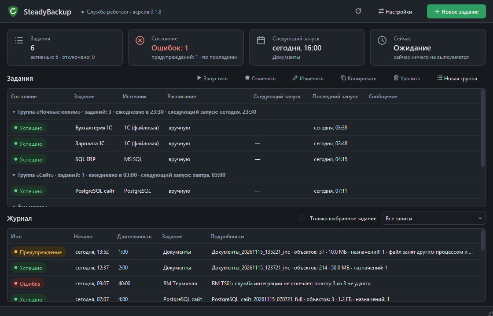
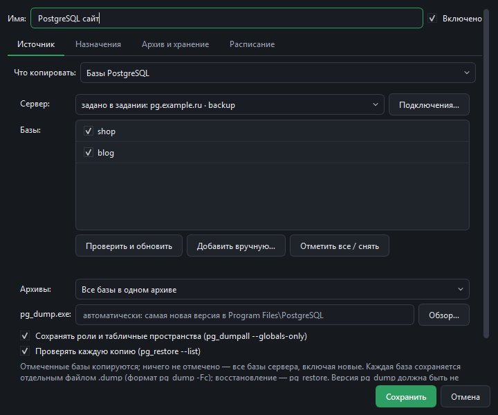

# SteadyBackup

Резервное копирование для Windows: файлы, файловые базы 1С, MS SQL, PostgreSQL, Firebird,
виртуальные машины Hyper-V, сайты на серверах Linux (MySQL/MariaDB и файлы по SSH) → 7-Zip → локальная папка, SMB, SFTP, WebDAV, Google Drive.
Расписания, группы заданий, ротация копий, повторы при ошибках, уведомления по e-mail и в Telegram.

Служба Windows (`steady.exe`, Rust) выполняет задания; окно настройки (`steady-gui.exe`, Qt 6)
общается с ней через именованный канал.

## Снимки экрана

Главное окно: задания по группам, состояние и журнал.



Задание PostgreSQL: выбор баз и архив на каждую базу.



Упаковка и хранение копий.


Расписание и повторы при ошибке.


На снимках — демонстрационные задания и вымышленные серверы.

## Установка

Установщик MSI — в разделе [Releases](../../releases).

## Сборка

```
build.cmd
```

Нужны Rust, Qt 6 (MSYS2 UCRT64), CMake, Ninja и WiX 3.14.

Встроенный вход в Google Drive требует секрета OAuth-клиента: переменная окружения
`STEADY_GDRIVE_SECRET` или файл `gdrive-secret.txt` в корне (в git не попадает). Без него программа
собирается, а для Google Drive в хранилище указывается свой Client ID и Client Secret.

## Лицензия

[MIT](LICENSE) Подробности — [AGENTS.md](AGENTS.md),
формат заданий — [examples/jobs.md](examples/jobs.md), устройство — [docs/ARCHITECTURE.md](docs/ARCHITECTURE.md).
