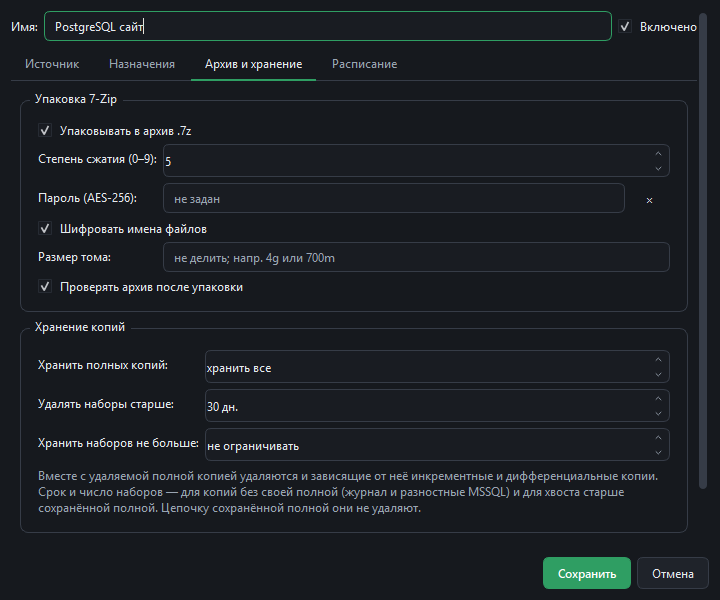
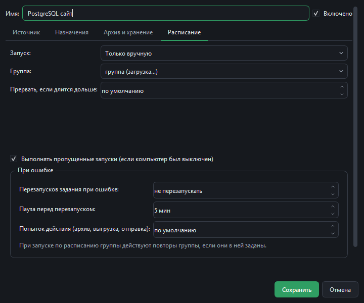

# SteadyBackup

Резервное копирование для Windows: файлы, файловые базы 1С, MS SQL, PostgreSQL, Firebird,
виртуальные машины Hyper-V → 7-Zip → локальная папка, SMB, SFTP, WebDAV, Google Drive.
Расписания, группы заданий, ротация копий, повторы при ошибках, уведомления по e-mail и в Telegram.

Служба Windows (`steady.exe`, Rust) выполняет задания; окно настройки (`steady-gui.exe`, Qt 6)
общается с ней через именованный канал.

## Снимки экрана

Главное окно: задания по группам, состояние и журнал.


Задание PostgreSQL: выбор баз и архив на каждую базу.


Упаковка и хранение копий.



Расписание и повторы при ошибке.



На снимках — демонстрационные задания и вымышленные серверы.

## Установка

Установщик MSI — в разделе [Releases](../../releases).

## Сборка

```
build.cmd
```

Нужны Rust, Qt 6 (MSYS2 UCRT64), CMake, Ninja и WiX 3.14. Подробности — [AGENTS.md](AGENTS.md),
формат заданий — [examples/jobs.md](examples/jobs.md), устройство — [docs/ARCHITECTURE.md](docs/ARCHITECTURE.md).
