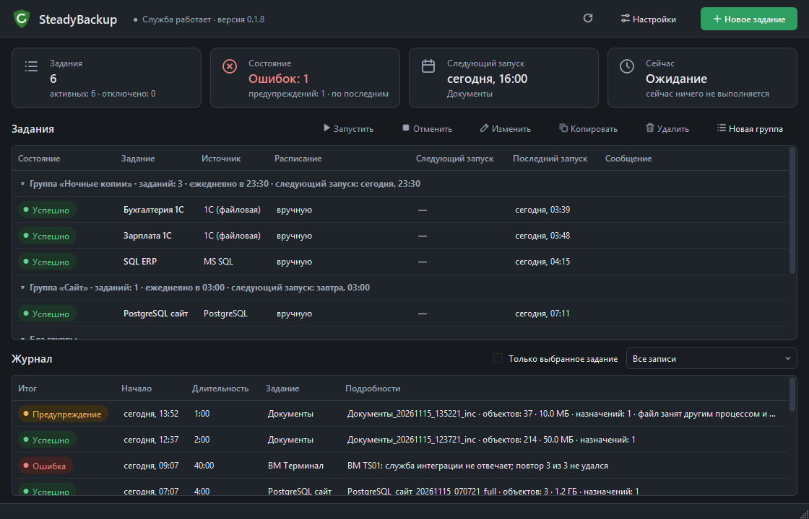

# SteadyBackup

Резервное копирование для Windows: файлы, файловые базы 1С, MS SQL, PostgreSQL, Firebird,
виртуальные машины Hyper-V, сайты на серверах Linux (MySQL/MariaDB и файлы по SSH) → 7-Zip →
локальная папка, SMB, SFTP, WebDAV, Google Drive. Бесплатно, исходный код открыт (лицензия MIT).

* [Скачать последнюю версию](https://github.com/bekapych/SteadyBackup/releases/latest)
* [Исходный код и описание](https://github.com/bekapych/SteadyBackup)
* [Политика конфиденциальности](privacy.html)

